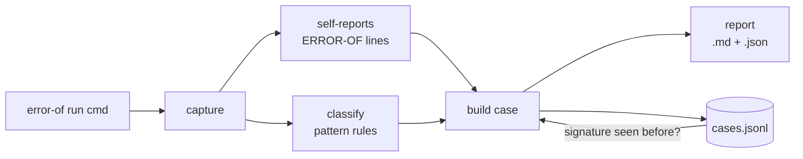

# error-of: architecture

## One sentence

`error-of` wraps **any command**, turns what it reports into a structured
*case* (boundary, assumption, invariant, transformation, outcome), and keeps
every case in an append-only knowledge base so patterns become visible over time.

## Three levels of participation

A program does not need to know about `error-of` to be observed. The more it
participates, the more first-hand the knowledge becomes.

| Level | What the program does | What error-of gets | Example |
|---|---|---|---|
| 0. Unaware | nothing; any language, any tool | stdout, stderr, exit code, runtime, classified by pattern | `error-of run git -C /tmp log` -> Context |
| 1. Speaks the protocol | prints `ERROR-OF {json}` lines to stderr | the program's own account of the boundary it met | `examples/pdf2html` |
| 2. Heals | wraps functions with `error_of.heal` (Python) | every heal attempt, its invariant result, and the outcome | `examples/self_heal_phinary.py` |

Level 0 works for bash, node, git, compilers, anything. Levels 1 and 2 are opt-in.

## Data flow



1. **capture** (`core.capture`) runs the command unchanged and records stdout,
   stderr, exit code, runtime and environment. The originals are never edited.
2. **self-reports** (`core.self_reports`) parses `ERROR-OF {json}` lines. These
   are the program's own observations and are ranked above pattern guesses.
3. **classify** (`core.classify`) matches stderr/stdout against rules. Each rule
   names a class, the boundary, the assumption it reveals, a possible invariant,
   and suggested transformations. Every inference records the rule and the text it
   matched ("explain every inference").
4. **signature** (`core.signature`) fingerprints the error with paths, numbers and
   addresses removed, so the same failure in a different place is recognised.
5. **build case** sets a status:
   - `clean`: exit 0, nothing reported
   - `continued`: exit 0 after the program reported and crossed boundaries
   - `stopped`: non-zero exit
6. **report** writes `output/<id>.md` and `output/<id>.json`.
7. **store** appends the case to `~/.error-of/cases.jsonl`. Nothing is rewritten
   ("learn without rewriting history").

## The case (what is stored)

```json
{
  "id": "64a8331be1",
  "command": ["python3", "pdf2html.py", "in.pdf"],
  "exit_code": 0, "runtime_s": 0.19, "status": "continued",
  "stdout": "...", "stderr": "...",
  "observations": [{"class": "Representation", "boundary": "...", "assumption": "...",
                    "invariant": "...", "transformation": "...", "outcome": "...",
                    "source": "self-report"}],
  "inferences":   [{"class": "...", "boundary": "...", "assumption": "...",
                    "invariant": "...", "transformations": ["..."],
                    "rule": "<regex>", "evidence": "<matched text>", "source": "pattern"}],
  "signature": "2552b5316bad", "seen_before": 0
}
```

## The observation protocol

One line on stderr, one JSON object:

```
ERROR-OF {"class": "...", "boundary": "...", "observation": "...",
          "assumption": "...", "invariant": "...", "transformation": "...", "outcome": "..."}
```

Any language can emit it (`echo`, `console.error`, `eprintln!`). Keys map to the
PRD pipeline: Error -> Boundary -> Observation -> Assumption -> Invariant ->
Transformation -> Continuation (`outcome`).

## Healing (`error_of/heal.py`)

```
error -> matching Heal? --no--> raise original
              | yes
              v
        transform(input) -> invariant(old, new)?
              | held                     | violated
              v                          v
           retry                  raise original (heal rejected)
```

Rules:
- A heal changes the **input or representation**, never code (PRD non-goal:
  automatic code fixer).
- A heal without an invariant is not accepted. The invariant is what separates
  healing from hiding: `"1011".replace("11","100")` removes the error and changes
  the number; its invariant rejects it.
- Every attempt is reported, accepted or not.

## Commands

| Command | Does |
|---|---|
| `error-of run <cmd>` | capture, classify, report, store; passes the original output through and keeps the exit code |
| `error-of report <id>` | print a stored case |
| `error-of search <text>` | search classes, boundaries and stderr across cases |
| `error-of patterns` | count classes and recurring signatures |

## Mapping to the PRD plugin layout

The MVP keeps everything in `error_of/core.py`. The seams are already functions,
so the split is mechanical when needed:

| PRD module | MVP location |
|---|---|
| `capture/` | `core.capture` |
| `classifiers/` | `core.RULES`, `core.classify`, `core.self_reports` |
| `transformers/` | `error_of/heal.py` (in-process); suggested transformations in rules |
| `reporters/` | `core.to_markdown`, JSON dump in `cli.py` |
| `storage/` | `core.store`, `core.load_cases` (JSONL) |

## Known limits

- Pattern rules are only as good as the rule table. Unmatched errors are marked
  `Unknown` explicitly, never guessed.
- A wrong invariant steers a healing loop wrong (seen in the pdf2html case study).
  Invariants need tests as much as code does.
- The knowledge base records what happened; it does not yet rank which
  transformation worked best for a signature. That is the next step: use
  `outcome` across cases to suggest the transformation that worked before.
